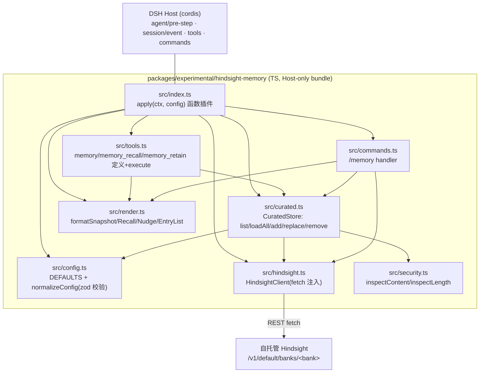

# Hindsight 全局记忆体插件 技术方案

> Feature：998-hindsight-memory-plugin | 有效需求来源：[spec/PRD.md](../spec/PRD.md)（FR-01..09、CR-01/02、BR-01..07、NFR-01..03、AC-01..11） | Profile：standard | 模板：mai-specs/_templates/TECH_DESIGN.tmpl.md | 代码基线：feat/hindsight-memory-plugin @ dsh-v0.2.2-rc.5 | 状态：待评审

## 1. 方案概述

### 1.1 设计目标和设计原则

把 `/Volumes/data/project/hindsight-memory`（JS，v0.2.0）平移移植为仓库包 `packages/experimental/hindsight-memory`（TS，strict），行为语义不变，工程形态满足仓库门禁。原则：

- **语义零漂移**：快照冻结、召回过滤、预算守卫、先写后删、lossless JSON、降级策略逐条对照基线源码实现；已知缺陷回归（RESEARCH §7）转为单测固化。
- **复用仓库机制**：工具走 `ctx.tools.register`（schema 用 schemastery/zod 声明替代手写 JSON Schema，与仓库 tool 定义规范一致）；命令走 `ctx.commands`；不引入任何第三方运行时依赖（Hindsight HTTP 仍用全局 fetch）。
- **可测性优先**：HTTP 层注入 `fetch` 替身（构造参数或 config 无关的模块内 seam），使全部逻辑可在 vitest 下 100% 覆盖；真机连通验证留给 e2e/验收。

不做：v0.3 纠错闭环、多 bank、服务端改造（PRD §7）。

### 1.2 整体架构



包目录结构（对齐 sdd-workbench 案例的清单接法）：

```
packages/experimental/hindsight-memory/
  package.json      # name=@deepseek-ai/dsh-hindsight-memory, exports ".", "./cordis.patch.yml",
                    # "./locale/*.json", "./package.json"; icon; dsh.bundle.patch; peer cordis+schemastery
  cordis.patch.yml  # insert hindsight-memory 行（config 注释同旧版）
  index? 无——入口 src/index.ts → lib/index.js
  src/{index,config,hindsight,curated,security,render,tools,commands,types}.ts
  tests/{hindsight,curated,security,render,tools,commands,index}.spec.ts   # vitest mock-fetch
  locale/{en,zh,de,es,fr,ja,pt,ru}.json  # meta.title/description/detail
  docs/DETAIL.md, icon.svg, README.md(+zh), tsconfig.json(tsconfig.base.json 引用 vendor/cordis、schemastery)
```

### 1.3 关键决策与 Review 索引

| 决策 | 推荐及理由 | 代价与备选 | 确认状态 | 详情 |
| ---- | ---------- | ---------- | -------- | ---- |
| D1a 注入消息形状按评审 P0-1 定稿：快照走 `form:'snapshot'+sections`，召回/nudge 走 `form:'notice'+summary`；一律 `createUserMessage()` 创建、经 MessageSourceMap 声明合并自定义 kind | 已核验 message.ts:70-100：snapshot form 强制 `sections: ContextSnapshotSection[]`（name+text），notice form 只需 ≤120 字符 summary；裸对象手搓在 strict+frozen+branded MessageId 下编译不过。先例 hooks-claude-code:19-23 的 declare module 同法注册两个 kind | 备选：全用 notice——快照正文超一行摘要语义，弃 | 已确认 | §2.3.1 |
| D1b 函数插件保留（`export function apply` + `inject=['tools']`），注入沿用基线"pre-step 并入 decision.messages"通道 | 评审复核纠正了初判：enter batch 消息由 loop 逐条 append 成 durable `user/message`（core/agent-loop/src/agent.ts:469-479），该通道本身即合规先例（time-context/hooks-claude-code/action-cards 同构），model-visible ⟺ logged 成立；真正缺陷只在消息**形状**（D1a）与**去重持久化**（D4），不在通道 | 改走 agent.inject 反而引入首步滑步问题（R-B2 分析） | 已确认 | §2.3.1 |
| D2 工具 schema 用手写 JSON Schema 原样迁移 or zod？ | 仓库 tool 定义主流是 `z.object` schemastery；但 memory 工具 parameters 含 enum/嵌套 operations，zod 重写工作量大且易漂移 → **MVP：保持 JSON Schema 字面量**（cordis ToolDefinition.parameters 接受 JSON Schema），output.render 保留 | 若门禁要求 zod 再局部改写 | 已确认（T4 首步以真实 ToolDefinition 类型验证） | §2.3.4 |
| D3 fetch 注入 seam：`new HindsightClient(config, deps?: { fetch })` | 单测可控超时/错误/载荷断言；生产默认 globalThis.fetch | mock module 替换脆弱 | 已确认 | §2.1.2 |
| D4 per-session 状态改投影（评审 P1-4） | apply 闭包 Map 在 fiber 重建/HMR/resume 后清零 → 快照重复注入、retainTurn 重复沉淀。改为注册一个 `sessionProjections` unit（time-context/tmux-context 模式）：fold `agent/inbox/spliced`+`user/message`（本插件 kind 计数=快照是否已注入、每轮 recall 是否已发）与 `assistant/message`（per-turn 文本缓存）、`turn/end`（沉淀去重）。纯 fold、stateVersion=1、plain JSON | 备选 (b) 接受重注入写进 README——否决：违反 AC-01 | 已确认 | §2.3.1 |
| D5 retainTurn 事件源改投影路径 | 已核验：`session.snapshotEvents()` 在仓库中标 **@deprecated（新调用禁止）**（core/session/src/index.ts:750-768 + Agent Note 2026-09-09）。改为订阅 `turn/end` 时同步读取该轮已收集文本：pre-step 阶段插件本就记录 lastUserText；助手最终文本从 `agent/assistant-stream` 聚合或退而求其次——**MVP 决策：retainTurn 仅沉淀「用户输入 + 触发时刻的 agent 状态摘要」不可接受（丢助手结论），故采用 session/event 内累计：监听 `assistant/message` 事件缓存 per-turn 文本，turn/end 落盘**。零 deprecated API 依赖 | 备选：projection 单元（ctx.sessionProjections）更合规但为单一消费者建投影属过度 | 已确认 | §2.3.3 |
| D6 url/bank 默认值保留 + README 警示（CR-01） | 运行期服务不可达静默降级（FR-07）；配置层面类型不符由 Loader schema fail loud（评审 P1-3 后与仓库规则一致，不再"回退+warn"） | 备选必填校验：拒绝加载——影响安装体验 | 已确认 | §2.2 |
| D7 测试从"真连 8888"改为 mock-fetch 单测 + 保留 integration.mjs 思路为可选 e2e | NFR-03 覆盖率门禁只能靠 mock；真机证据归 AC 验收记录 | — | 已确认 | §3 T6 |

减法检查结论：不加 Remote 命名空间（无 UI）、不加 typert 生成面（无跨进程调用方）、不引 storage-service（快照缓存留在内存即可）——删除这些后 AC 全可满足。

## 2. 详细设计方案

### 2.1 核心结构设计

#### 2.1.1 数据结构（src/types.ts，纯类型）

```ts
/** curated 记忆目标库。 */
export type MemoryTarget = 'user' | 'memory'
/** 一条 curated 条目（document 视图）。 */
export interface MemoryEntry { readonly id: string; readonly content: string; readonly chars: number; readonly createdAt: string }
/** 两库读取结果。 */
export interface LoadedStores { readonly user: readonly MemoryEntry[]; readonly memory: readonly MemoryEntry[]; readonly usage: UsagePair }
export interface UsageSide { readonly chars: number; readonly limit: number; readonly count: number }
export interface UsagePair { readonly user: UsageSide; readonly memory: UsageSide }
/** store 操作统一返回：成功带视图字段，失败带 kind+reason；未用字段一律缺席而非 undefined（BR-05）。 */
export type StoreResult =
  | ({ readonly ok: true } & Record<string, unknown>)
  | { readonly ok: false; readonly kind: 'secret'|'injection'|'empty'|'too_long'|'over_budget'|'no_match'|'ambiguous'; readonly reason: string; readonly entries?: readonly MemoryEntry[]; readonly usage?: UsageSide }
/** recall fact 视图。 */
export interface RecallFact { readonly id: string; readonly text: string; readonly tags: readonly string[]; readonly factType: string }
```

配置接口 `HindsightMemoryConfig` = 旧 DEFAULTS 18 键逐一对应（url/bank/userCharLimit/memoryCharLimit/snapshot/autoRecall/recallTokens/autoRetain/retainMinChars/maxRetainChars/nudgeInterval/tags/timeoutMs/retainTimeoutMs/maxEntryChars/maxInjectedChars/protectSecrets/maxEntries），`static Config` 用 `z.object` 声明并给同样的 default —— 由 Loader 完成校验与默认填充（非法类型 fail loud at load，仓库规则）；`normalizeConfig` 仅做值域归一：url 尾斜杠剥离、tags 元素清洗、整数键 Math.floor 化。**删除全部类型回退分支**（评审 P1-3：双轨校验在覆盖率门禁下产生不可达死代码）。同理 client 的 combineSignals 手动转发兜底分支在 Node>=24.9 不可达，删除，直接用 AbortSignal.any。协议常量固定不进 Config：`CURATED_TAG='curated'`、`mem:user/mem:memory/mem:session`、id 前缀 `dsh-mem-/dsh-turn-/dsh-note-`、`CHARS_PER_TOKEN=2.75`。

#### 2.1.2 数据流

- **快照**：pre-step(step===1, decision.kind==='enter') → `store.loadAll()`（list×2 并发；每 target 内 listDocuments→readDetails 8 路并发 GET）→ formatSnapshot → append contextMessage(kind='hindsight-memory')。state.snapshotLoaded 置位后本会话不再触发；失败 snapshotFailed=true 静默（FR-07）。
- **召回**：turn>1 且 query（lastUserText 排除 OWN/FOREIGN kinds）非空且 lastRecallTurn!==turn → client.recall(query,{maxTokens}) → filter(!tags.includes(CURATED_TAG)) → formatRecall append。
- **nudge**：turn % nudgeInterval === 0 → formatNudge append（与快照/召回合并为一条消息，同基线）。
- **沉淀**：session/event turn/end → retainedTurns 去重 → void retainTurn(...)（fire-and-forget，内部 try/catch 全包）。
- **写入路径全景**：tools.memory / memory_retain / commands forget 全部经 security.inspectContent 前置（BR-06）。
- **fetch seam**：`class HindsightClient { constructor(config, private readonly fetchImpl: typeof fetch = globalThis.fetch) }`；combineSignals/超时可测。

失败路径映射：unreachable/http 错误码 → HindsightError{code}；调用侧 catch 决定静默（注入类）或转工具错误文案（交互类）。

#### 2.1.3 接口设计

对外可见面（模型/人类）与旧版逐字一致（描述文本、参数名、渲染格式全部平移，避免 prompt 漂移）。内部 TS 面：

```ts
// hindsight.ts —— 方法签名同基线：recall/listDocuments/getDocument/retainDocument/deleteDocument/stats
// curated.ts —— CuratedStore.list(target)/loadAll()/add/replace/remove + findUniqueEntry/normalizeForMatch 导出供测
// tools.ts —— createMemoryTool(deps): ToolDefinition<HindsightConfig…>（parameters JSON Schema 原样迁移）
// index.ts  —— export const inject=['tools']; export function apply(ctx, rawConfig): void
```

错误约定：client 抛 HindsightError；store 不抛（catch 转 StoreResult.ok=false kind='unreachable'... 由 T4 定：基线 store 让异常穿透到工具 execute 的 catch——保持一致，工具层统一兜底文案「无法连接 Hindsight…」）。

### 2.2 配置变更

bundle patch 一行 insert（同旧版全文注释平移，改 name 为 `@deepseek-ai/dsh-hindsight-memory`）。仓库清单三处：apps/cli/package.json 依赖、official-bundles OPTIONAL_BUNDLES + EXPERIMENTAL_BUNDLES、scripts/experimental-package-policy.ts EXCEPTIONS 登记 `'packages/experimental/hindsight-memory': '@deepseek-ai/dsh-hindsight-memory'`。tsconfig.host.json 加引用。无新增用户配置文件。

### 2.3 分模块详细设计

#### 2.3.1 index.ts（装配）

normalizeConfig→client/store/states→注册 3 工具→`ctx.get('commands')` 存在才注册 /memory（CommandDefinition{name,description,input:{hint,attachments:false},handler→CommandResult{kind:'success'|'error',text}}，interaction/commands/src/index.ts:61-80；register() disposer 必须挂 ctx.effect；命令名 `memory` 符合命名正则 ✓）。

**source 声明**（模块顶层）：

```ts
declare module '@deepseek-ai/dsh-llm' {
  interface MessageSourceMap {
    /** curated 记忆快照注入。 */
    'hindsight-memory': { kind: 'hindsight-memory' } & ContextFormed
    /** 记忆审查提醒注入。 */
    'hindsight-memory-nudge': { kind: 'hindsight-memory-nudge' } & ContextFormed
  }
}
```

**注入构造（P0-1 修复）**：全部经 `createUserMessage()`（自动 mint branded id + deep-freeze）：

```ts
// 快照：snapshot form + 具名 section（框架据此可做深比较去重的语义位点；我们的持久去重见投影）
const snapshotMessage = createUserMessage({
  content: [{ type: 'text', text: formatSnapshot(loaded, config) }],
  source: { kind: 'hindsight-memory', form: 'snapshot', sections: [{ name: 'hindsight-memory', text: rendered }] },
})
// 召回块：一次性事件 → notice（summary ≤120，boundContextSummary）
createUserMessage({ content: [...], source: { kind: 'hindsight-memory', form: 'notice', summary: boundContextSummary(`相关记忆 ${n} 条`) } })
// nudge：独立 kind 的 notice
createUserMessage({ content: [...], source: { kind: 'hindsight-memory-nudge', form: 'notice', summary: `第 ${turn} 轮记忆审查提醒` } })
```

**注入通道（定稿）**：pre-step `await next()` 先行后，在 step===1 且投影判定"本会话尚无快照"时，把 createUserMessage 产物直接并入返回值 `{ ...decision, messages: [...decision.messages, snapshotMessage] }`——enter batch 由 loop 逐条 append 为 durable `user/message`（agent.ts:469-479），天然满足 model-visible ⟺ logged，且首条回复即可见（R-B2 主路径）。召回/nudge 同理随当次 decision 追加。`agent.inject()` 仅保留给 turn 中途产生的补充上下文（如工具写库后的确认提示，MVP 暂不使用）。spread 保 startsRequestSeries 等字段（waterfall 硬规则）。

**持久去重（D4 投影）**：`sessionProjections` unit fold 本 Session 事件流，状态 `{ snapshotInjected: boolean, lastRecallTurn: number, turnTexts: Record<turn,{user?,assistant?}>, retainedTurns: number[] }`；输入来自 `user/message`（source.kind ∈ 两 kind ⇒ snapshotInjected=true）、`agent/pre-step` 不可 fold（非会话事件）故召回节流用"本轮 user/message 中无本 kind notice"判定 + turn 号比较；`assistant/message` 覆盖式累计本轮助手文本；`turn/end` 提供沉淀触发核对。resume/fork 后投影从日志重建，杜绝重复注入。OWN_KINDS/FOREIGN_KINDS 集合原样（lastUserText 排除逻辑不变）。

#### 2.3.2 config.ts / security.ts / render.ts

逐函数平移 TS 化：DEFAULTS→interface+静态 z 声明（见 §2.1.1）；security 正则表原样（含中文变体），返回判别联合；render 的 estimateTokens/usageLabel/formatEntryList/formatSnapshot/formatRecall/formatNudge/formatStatus/clampText 全保留，文案逐字平移（快照尾部"写入规则"两行是用户长期依赖的口径）。

#### 2.3.3 curated.ts / retainTurn

findUniqueEntry（exact→folded→歧义候选）、readDetails(8)、add/replace/remove 预算数学与先写后删序完全保留。retainTurn 的事件读取按 D5 适配仓库 Session API（候选：`session.events` 数组过滤 assistant/message+turn 匹配；或 projection）。id 生成 randomId 保留 crypto.randomUUID 优先 + 时间戳兜底。

#### 2.3.4 tools.ts / commands.ts

三个工具的 name/description/parameters/output.schema/output.render/execute 全量平移。parameters 保持 raw JSON Schema（评审 A 项确认：ToolsService.register 不强校验 parameters，且 defineTool DSL 拒绝 minimum/maximum，raw 路线成立且必要；execute 内手工校验参数边界）。output.schema 过 assertSupportedJsonSchema——基线子集语法可过。memory 工具保留 `timeoutMs: max(retainTimeoutMs, timeoutMs)+5000`（cooperative budget，wrapper 执行；execute 已透传 exec.signal ✓）。返回值组装点显式条件挂字段——lossless 的真实执行点在 pipeline snapshotToolValue，TS 类型帮不上，靠条件挂载纪律 + assertLossless 回归单测（BR-05）。batch runBatch 顺序执行、聚合 entries/usage、failures>0 才挂 reason——保留。commands handler 分支 status/list/search/forget/stats 平移，返回 CommandResult（§2.3.4 旧稿"CommandInfo"为笔误已删）。

### 2.4 供评审的代码设计（for review check）

```ts
// curated.replace 核心序（先写后删，写失败不动旧条目；AC-04）
async replace(target: MemoryTarget, oldText: string, content: string, options: OpOptions = {}): Promise<StoreResult> {
  const text = typeof content === 'string' ? content.trim() : ''
  const checked = inspectContent(text, { protectSecrets: this.config.protectSecrets })
  if (!checked.ok) return { ok: false, kind: checked.kind, reason: checked.reason }
  const entries = await this.list(target, options)
  const matched = findUniqueEntry(entries, oldText)
  if (matched.entry === undefined) return { ok: false, kind: 'no_match', reason: matched.reason, entries }
  // …长度/预算校验同 add（nextTotal = current - old.chars + text.length）…
  const id = randomId('dsh-mem')
  await this.client.retainDocument({ id, content: text, tags: [...this.config.tags, CURATED_TAG, targetTag(target)],
    context: `curated memory (${target})`, metadata: { source: 'dsh-memory', target, schema: 'curated-v1' } }, options)
  await this.client.deleteDocument(matched.entry.id, options)   // retain 抛错时此行不可达 → 旧条目完好
  return { ok: true, action: 'replace', target, entry: { id, content: text }, replaced: matched.entry, entries: next }
}

// index.ts pre-step（waterfall 纪律：next() 先行；spread 保字段；自身异常吞掉不影响主流程）
ctx.on('agent/pre-step', async (payload, next) => {
  const decision = await next()
  try {
    if (decision?.kind !== 'enter' || payload?.step !== 1) return decision
    /* 快照/召回/nudge parts 组装（同基线） */
    if (parts.length === 0) return decision
    return { ...decision, messages: [...decision.messages, contextMessage(parts.join('\n\n'), 'hindsight-memory')] }
  } catch { return decision }
})
```

Review 索引：R-1 lossless 返回值的 TS 表达是否杜绝 undefined（判别联合 vs 条件挂载）；R-2 retainTurn 事件源适配正确性（D5）；R-3 快照并发与 abort 传播；R-4 JSON Schema 参数面与 zod 门禁的冲突预案（D2）；R-B2 inject 首步可见性实测口径（§4 风险条）。

## 3. 实施任务

| 任务 | 内容 | 涉及文件 | 验证 | 依赖 |
|---|---|---|---|---|
| T1 | 包骨架：package.json(**模板照抄 terminal-bundle**：exports ./cordis.patch.yml+./locale/*.json+icon)/tsconfig/patch/locale×8(meta.title/description/detail 全翻译、detail 句号结尾)/**36×36 新 icon**(svgArtworkProblems 强制，旧 64×64 废)/docs/DETAIL.md+README 双语+i18n.yaml；清单登记：apps/cli 依赖、OPTIONAL_BUNDLES+EXPERIMENTAL_BUNDLES、EXCEPTIONS、tsconfig.host.json；跑 gen-tsconfig-paths；记录 tool-catalog 不适用判定（目录名不命中 glob） | packages/experimental/hindsight-memory/*; apps/cli/package.json; official-bundles×2; experimental-package-policy.ts; tsconfig.* | pnpm install + build + verify-locale-metadata/verify-package-meta 通过 | — |
| T2 | types/config/security/render TS 平移 + 单测 | src/{types,config,security,render}.ts, tests/* | vitest 绿；正则样本矩阵 | T1 |
| T3 | hindsight client（fetch 注入）+ 单测（超时/重试面无/载荷断言） | src/hindsight.ts, tests/hindsight.spec.ts | vitest | T2 |
| T4 | curated store + index 装配 + tools/commands（含 D2/D5 现场核验） | src/{curated,index,tools,commands}.ts | vitest + typecheck | T3 |
| T5 | 行为回归套件：assertLossless 转单测、预算/先写后删/降级/去重矩阵 | tests/{tools,curated,index}.spec.ts | vitest 100% 覆盖 src | T4 |
| T6 | 门禁收口：test:coverage 本包达标（index.spec.ts 打满 src/index.ts）、lint、hygiene、**pnpm run gen-config-catalog**（新 Config 入 catalog）+ doc-sync、README 升级指引（旧 link 安装需先 remove_bundle 再装新包，防同 id insert 静默替换） | docs/config-catalog.md(+zh) | pnpm run build/test/lint/doc-sync | T5 |
| T7 | 真机验收：源码 dsh web 装 bundle → AC-01..11 走查（本机 Hindsight 可用） | ACCEPTANCE.md | 人工+RPC 证据 | T6 |

## 4. 风险与回滚

- **R-B2 inject 首步可见性**：agent.inject 于 pre-step 内调用时，本次 enter batch 已 claim 完毕 → 快照可能滑到下一个 step boundary（同一请求内后续 step 或 followup）。缓解：投影已知未注入且在 step===1 时，除 inject 外同时把消息放入当次 decision.messages 返回（`{...decision, messages:[...]}` 展开保 startsRequestSeries；消息本身仍是 createUserMessage 产物，loop 会将其 append 为 durable user/message——agent.ts:469-479 证实 enter batch 逐条落日志，合规）。即：**首选 pre-step 直改 decision.messages（durable 由 loop 负责），inject 仅用于 step 中途新增的场景**。AC-01 真机验证"第一条回复即带记忆"。
- **per-turn 缓存内存上界（D5）**：assistant/message 全文可能长；maxRetainChars 截断在写侧已有，缓存侧再加"仅存最后一条助手消息"策略（同基线行为：覆盖式 assistantText），无累积风险。
- **JSON Schema 参数面（D2）**：若 publint/export-jsdoc 门禁强制 zod，转换仅触及 tools.ts 一个文件，语义不变。
- **外部服务耦合**：CI 无 8888 服务 → 全部单测 mock；真机项只在本地验收记录，README 写明前提。
- **回滚**：experimental 目录 + 四段清单各一行 revert 即净；OPTIONAL_BUNDLES 摘除后 profile 停用即无痕。

## 5. 评审结论与修订记录

（待 my-review-design 填写）
