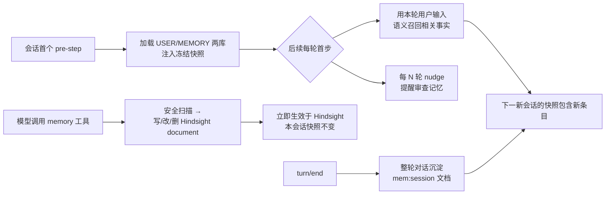

# PRD：Hindsight 全局记忆体插件

> 状态：评审通过 | 负责人：liliang302

[返回需求简报](../BRIEF.md)

## 1. 背景与目标（Why）

- **背景/痛点**：DSH 会话上下文随轮次线性膨胀，跨会话的经验、用户偏好与环境事实无处沉淀。用户已在个人环境运行 hindsight-memory v0.2.0（JS 独立工作区），机制对齐 Hermes Agent 的 MEMORY.md/USER.md，验证记录完整；但未按 DSH 仓库规范交付，无法随 fork 分发。
- **目标**：把该插件移植为仓库内规范的 optional bundle（`@deepseek-ai/dsh-hindsight-memory`），让任何接入自托管 Hindsight 服务的 DSH 用户在安装启用后获得：会话开始的全局记忆快照、逐轮相关记忆召回、模型可控的长期记忆读写工具、每轮对话自动沉淀，以及凭据/注入内容的安全拦截。
- **成功指标**：按 README 命令在新环境完成安装→启用→一次真实会话内完成"写入一条记忆 → 新会话可见快照含该条"闭环 ≤ 5 分钟。

## 2. 用户与场景（Who / When）

| 用户故事 ID | 目标用户 | 触发场景 | 用户故事 | 关联需求 |
|---|---|---|---|---|
| US-01 | DSH 用户（有自托管 Hindsight） | 开启新会话 | 作为用户，我希望助手开场就"记得"我的偏好与项目约定，以便不用重复交代 | FR-01 |
| US-02 | 同上 | 对话中出现值得长期保留的事实/纠正 | 作为用户，我希望助手主动把结论写进记忆并可在后续会话召回，以便经验持续复用 | FR-02, FR-03, FR-05 |
| US-03 | 同上 | 讨论话题与历史决策相关 | 作为用户，我希望每轮自动带入相关的历史事实，以便助手引用旧决定不失忆 | FR-04 |
| US-04 | 谨慎型用户 | 担心敏感信息入库 | 作为用户，我要求凭据与提示注入文本被拒绝写入 | FR-06 |
| US-05 | 运维者 | Hindsight 服务停机/网络故障 | 作为用户，我要求记忆功能失效时对话照常进行，最多不注入 | FR-07 |
| US-06 | 人类用户 | 想直接查看/清理记忆 | 作为用户，我希望用 `/memory` 命令不经模型查看状态、检索、删除条目 | FR-08 |

## 3. 总体业务流程

### BF-01：一次会话的记忆生命周期

**流程说明**：快照在会话内冻结是刻意设计（保护前缀缓存，BR-02）；新会话重新加载即见全部更新。

## 4. 功能需求（What）

### 4.1 新增需求（相对 DSH 本体；相对旧 JS 版为移植+规范化）

| 需求编号 | 触发条件 | 输入 | 预期行为 | 输出/结果 | 关联 |
|---|---|---|---|---|---|
| FR-01 会话快照 | 每会话首次进入模型步骤 | 当前 Session | 读取 USER、MEMORY 两库全部 curated 条目，按预算渲染成一条注入消息（含占用百分比） | 模型上下文出现 `[长期记忆 · 会话快照]` 块；整个会话只注入一次 | US-01 |
| FR-02 memory 工具 | 模型显式调用 | action=add/replace/remove/batch/list + target=user/memory + content/old_text/id | 定位→校验→写入 Hindsight document；replace 为整条覆盖（先写新再删旧防丢数据）；batch 顺序执行；list 返回条目与预算占用 | 结构化结果：成功摘要或失败原因（歧义候选、超预算附当前清单）；返回值不含 undefined 字段 | US-02 |
| FR-03 字符预算 | add/replace 提交时 | 目标库当前总字数 + 新内容 | 超过 userCharLimit/memoryCharLimit 时拒绝写入，返回 kind=over_budget、当前条目与占用，引导先压缩 | 预算永不越界；超限操作可观察 | FR-02, US-02 |
| FR-04 语义召回 | turn>1 的每轮首步 | 本轮最后一条真实用户输入（排除插件自身与框架注入消息） | 调 Hindsight recall（max_tokens=recallTokens），过滤掉 curated 标签避免与快照重复 | 命中时注入 `[相关召回]` 块；无命中/失败不注入 | US-03 |
| FR-05 自动沉淀 | 每个 turn/end | 本轮用户文本+最终助手回复 | 拼接原文（≥retainMinChars，≤maxRetainChars 截断），以 `dsh-turn-*` id 写 mem:session 文档；同轮去重；fire-and-forget | Hindsight 中可按 tag 检索到轮次记录；不阻塞对话 | US-02, US-05 |
| FR-06 安全拦截 | 一切写入路径（工具/沉淀/命令） | 待写内容 | 凭据形态（私钥块、sk-/ghp_/AKIA/xoxb/JWT、口令赋值中英变体）与提示注入句式命中即拒绝；注入拦截不可关闭 | 拒绝消息说明改写建议；protectSecrets=false 仅放开密钥类 | US-04 |
| FR-07 失败降级 | Hindsight 不可达/超时/非 2xx | — | 快照/召回/沉淀静默跳过，工具调用返回明确的服务不可用错误；对话主流程不受影响 | 无未捕获异常、无 UI 报错弹窗 | US-05 |
| FR-08 /memory 命令 | 人类输入 `/memory …` | status/list/search/forget/stats 子命令 | 直连 Hindsight 执行，结果即时回显；forget 需精确 id | 人类不经模型管理记忆 | US-06 |
| FR-09 nudge | turn % nudgeInterval == 0 | 当前轮次 | 注入审查提醒文本 | 模型被周期性提示沉淀/纠错 | US-02 |

### 4.2 变更需求

| 需求编号 | 触发条件 | 原行为 → 本次行为 | 关联 |
|---|---|---|---|
| CR-01 | 配置缺失 url/bank | 旧版默认 `http://127.0.0.1:8888`/`hermes` → 新版保留该默认值但在包 README 明示"个人环境值，生产部署必须显式配置"；配置类型非法仍回退默认并记 warn | FR-07 |
| CR-02 | 包形态 | 独立 JS 工作区 `hindsight-memory` → 仓库 TS 包 `@deepseek-ai/dsh-hindsight-memory`（packages/experimental/），进入 OPTIONAL_BUNDLES/EXPERIMENTAL_BUNDLES 清单，经 Plugins 页安装 | 全部 |

## 5. UI 视觉与交互

纯 Host 插件，无页面。可见面 = 模型注入文本格式（快照/召回/nudge 块样式沿用旧版模板）+ Plugins 页的标题/描述/图标（locale meta）。

## 6. 业务规则与约束

| 规则 ID | 规则 | 关联 |
|---|---|---|
| BR-01 | 一条事实只进一个库（user/memory）；工具描述与快照尾部均声明该规则 | FR-02 |
| BR-02 | 快照会话内冻结；会话内写入不回灌快照（前缀缓存保护），写入效果下一会话可见 | FR-01, FR-02 |
| BR-03 | 所有插件注入消息带 source.kind ∈ {hindsight-memory, hindsight-memory-nudge}，召回取"用户输入"时必须排除自身与框架注入 | FR-04 |
| BR-04 | curated 文档 tag 必含 `curated`+`mem:user|mem:memory`；沉淀文档 tag=`mem:session`；两类查询互不混入（all_strict） | FR-01..FR-05 |
| BR-05 | 工具/命令返回值不得含 undefined 字段（lossless JSON 硬约束） | FR-02, FR-08 |
| BR-06 | 凭据与注入拦截先于任何写动作执行 | FR-06 |
| BR-07 | 插件零第三方运行时依赖；对 Hindsight 只用 documents/recall/memories/stats 已实测端点 | 全部 |

| 非功能 ID | 要求 | 验证口径 |
|---|---|---|
| NFR-01 | 快照加载并发 GET ≤8 路，50 条规模 <3s；recall 超时 timeoutMs(8s)、retain 超时 retainTimeoutMs(30s) | mock 计时单测 |
| NFR-02 | 任一 Hindsight 调用失败不产生 unhandled rejection | 停服 e2e |
| NFR-03 | 单测对 packages/experimental/hindsight-memory/src 行覆盖 100%（CI 门禁） | test:coverage |

## 7. 范围与边界

- **包含**：FR-01..FR-09 全部能力 + CR-01/CR-02 规范化移植 + 测试体系重建（mock 单测 + 可选真机 e2e）。
- **不包含**：v0.3 纠错闭环（DESIGN-curation-loop.md：mark_incorrect/update_memory/propose_rule/异步审计——另立 Feature）；服务端本身改造；多 bank 支持。
- **依赖**：外部自托管 Hindsight（REST API v1/default/banks/<bank>）；DSH Web/Desktop profile 均可装（Host-only）。

## 8. 研发资源

| 资源 ID | 类型 | 位置 | 用途 | 状态 |
|---|---|---|---|---|
| RES-01 | 基线源码 | context/baseline/（index.js+lib×7+tests） | 移植对照真源 | 已归档 |
| RES-02 | 调研笔记 | [context/RESEARCH.md](context/RESEARCH.md) | API 实测事实与缺陷史 | 已核验 |
| RES-03 | 旧验证矩阵 | [context/VERIFICATION.md](context/VERIFICATION.md) | AC 用例来源 | 已核验 |
| RES-04 | 图标 | icon.svg（沿用旧版） | 显示元数据 | 已有 |

## 9. 验收标准

### AC-01 快照注入闭环
**关联**：FR-01, BR-02 — Given 服务中有 ≥2 条两库条目且插件启用；When 开新会话发第一条消息；Then 上下文含 `[长期记忆]` 快照块、两库各至少一条、占用百分比；同一会话第二轮不重复注入。**验证**：单测断言 pre-step 消息 + 真机人工核对。

### AC-02 写入→新会话可见
**关联**：FR-02, FR-01 — Given 会话 A；When 模型 memory add 一条并得到成功回执；Then 会话 A 内快照不变；新开会话 B 的快照包含该条。**验证**：集成测试（mock fetch 双 session 模拟）+ 真机抽查。

### AC-03 预算守卫
**关联**：FR-03 — Given 库接近上限；When add 超限内容；Then 返回 over_budget + 当前条目 + usage，且 Hindsight 无新写入。**验证**：单测正反例。

### AC-04 replace 语义
**关联**：FR-02 — Given old_text 命中唯一条目；When replace；Then 新 document 写入成功后旧 document 删除；old_text 歧义时返回候选且不写。**验证**：单测（含写失败不动旧的失败序）。

### AC-05 召回过滤正确
**关联**：FR-04, BR-03 — Given 本轮输入命中历史 fact；When turn>1 首步；Then 注入召回块且不含 curated 标签条目；插件自身注入文本不会被当查询。**验证**：单测 lastUserText 排除逻辑 + recall 参数断言。

### AC-06 沉淀与去重
**关联**：FR-05 — Given autoRetain；When 同轮两次 turn/end 事件；Then 仅写一条 mem:session 文档，短轮(<retainMinChars)不写。**验证**：单测。

### AC-07 安全拦截
**关联**：FR-06, BR-06 — Given 各类凭据/注入样本（≥7+6 形态）；When 任意写入路径提交；Then 全部拒绝且原因可读；protectSecrets=false 时仅密钥类放开。**验证**：样本矩阵单测。

### AC-08 降级不崩
**关联**：FR-07, NFR-02 — Given 服务不可达；When 快照/召回/沉淀/工具四类调用；Then 前三者静默、工具返回服务不可用文案；进程无 unhandled rejection。**验证**：mock 抛错单测 + 停服 e2e。

### AC-09 /memory 命令
**关联**：FR-08 — Given commands 服务存在；When /memory status/list/search/forget；Then 输出与库一致；forget 错 id 明确报错。**验证**：单测 handler。

### AC-10 安装与注册
**关联**：CR-02 — Given 干净 profile；When Plugins 页 Add plugin 指向仓库包目录并启用；Then 插件行激活、三工具+命令注册、Plugins 页显示本地化标题描述；停用后全部消失。**验证**：真机步骤 + inspect。

### AC-11 仓库门禁
**关联**：NFR-03, BR-05, CR-02 — `pnpm run build`、`pnpm run test:coverage`（本包 100%）、lint、hygiene 全绿；工具返回值 lossless 断言保留为回归测试。**验证**：CI 等价本地命令。

## 待确认事项

无（两处历史问题已定案：配置默认值策略见 CR-01；v0.3 排除见 §7）。

## 变更记录

| 日期 | 变更及依据 | 影响 |
|---|---|---|
| 2026-11-20 | 初版：基于旧版 README/RESEARCH/VERIFICATION 三材料提炼，能力全集平移 + 规范化移植增量 | 全部 |
