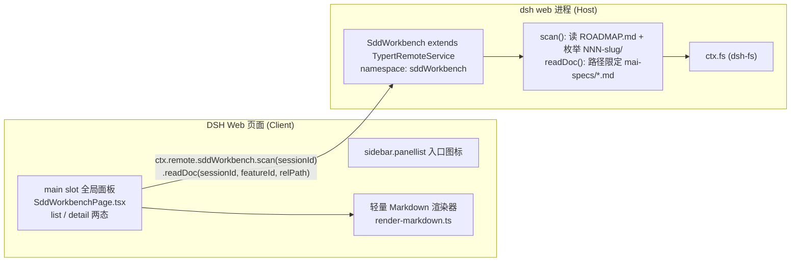

# SDD 工作台面板 技术方案

> Feature：999-sdd-workbench-panel | 有效需求来源：[spec/PRD.md](../spec/PRD.md)（FR-01..05、BR-01..04、NFR-01..03、AC-01..05） | Profile：standard | 模板：mai-specs/_templates/TECH_DESIGN.tmpl.md | 代码基线：feat/sdd-workbench-plugin @ dsh-v0.2.2-rc.5 | 状态：已确认（评审通过，见 review/DESIGN_REVIEW.md）

## 1. 方案概述

### 1.1 设计目标和设计原则

交付一个可在 DSH Web 中安装运行的插件 bundle，实现 PRD 的 FR-01～FR-05：侧边栏入口 → Feature 列表（含阶段产物完整度）→ 文档详情（Markdown 轻量渲染）→ 刷新。原则：

- **纯扩展点实现**：不修改任何既有内核包；新增两个实验区包（Host+Remote 服务包、Client UI 包），由一个 bundle patch 组合插入——与官方 `voice-input-bundle`（api-speech-to-text + client-ui-voice-input）同构。
- **复用现有通道**：文件读取复用 `dsh-fs`（Host）与 Typert Remote（Client↔Host），不新造传输层。
- **零运行时第三方依赖**：Markdown 用自研轻量渲染器（约 150 行），满足 NFR/BR 即可。

不做：编辑、阶段推进、多根聚合、图片代理（PRD §7）。

### 1.2 整体架构



工作区根解析（已按真实代码核验）：Client 以 `ctx.uiSession.adapter.current.getSnapshot().key`（无 Session 时为 `undefined`，见 `packages/client/ui-session/src/client/index.ts` materializeAbsent）作为 wire 上的可空 `sessionId: string | null`。Host 端两分支：

- 有 sessionId：`ctx.sessions.get(sessionId)?.header?.cwd ?? ctx.sandboxPolicy.workspaceRoot`——与 `workspaceFiles` lookup 同语义（`packages/api/workspace-files/src/index.ts:223-231`）。
- 无 sessionId：直接 `ctx.sandboxPolicy.workspaceRoot`（`packages/sandbox/sandbox-policy/src/index.ts:164`，默认 `process.cwd()`，即 `pnpm dsh web` 的启动目录）。

不借用 `workspaceFileScope` typert lookup：该 lookup 对无效 sessionId 返回 `undefined` 并抛 `gateway/session-not-found`（AC-03 要求空态而非报错），且其 read 面允许任意工作区内路径；本插件需要更窄的面（仅 mai-specs 子树 + `.md`），自建校验更小更安全。

### 1.3 关键决策与 Review 索引

| 决策 | 推荐及理由 | 代价与备选 | 待判断事项/确认状态 | 详情 |
| ---- | ---------- | ---------- | ------------------- | ---- |
| D1 挂载形态：`main` 全局面板 + `sidebar.panellist` 入口 | 面板属于项目而非单个 Session，与 Plugins 页同型；有 `ui-plugin-manager/src/client/index.ts` L129-175 现成参照 | 备选：右侧 tab（session 作用域）——语义不符，Feature 列表跨 Session | 已确认 | §2.3.2 |
| D2 数据通道：自建 `TypertRemoteService`（namespace `sddWorkbench`） | 需要"扫描 mai-specs 并解析"的组合逻辑，放在 Host 一次成型；泛化的 `workspaceFiles.listDirectory+streamText` 需 Client 多次往返且把领域解析漏到前端 | 备选：Client 直接调 workspaceFiles——请求数×文档数，且越界防护要重做 | 已确认 | §2.1.3 |
| D3 Markdown 渲染：自研子集渲染器 | 仓库先例（session-inspector 手写视图）；引入 markdown-it 等会带外部依赖进 client bundle，违反 MVP 与 hygiene 检查倾向 | 备选：宿主 ui-sidebar-documentpreview 的文本预览——那是 session 右栏机制，不适用于全局面板 | 已确认 | §2.3.3 |
| D4 包放置：`packages/experimental/{sdd-workbench, client-ui-sdd-workbench}` + bundle patch 在 sdd-workbench 内 | 作业场景是社区插件；experimental 区是官方可选能力落点，patch 单文件即可安装 | 备选：完全独立仓库 bundle——无法随 fork 一起提交评审 | 已确认 | §2.2 |
| D5 标题/Phase 解析失败降级 | BR-03：ROADMAP 或 BRIEF 解析失败只影响展示字段，不影响列表可用 | 更严格方案（报错拒载）损失可用性 | 已确认 | §2.1.2 |

## 2. 详细设计方案

### 2.1 核心结构设计

#### 2.1.1 数据结构设计

Host→Client 契约（`packages/experimental/sdd-workbench/src/types.ts`）：

```ts
/** 一个 SDD Feature 目录的扫描结果。 */
export interface SddFeatureSummary {
  /** 目录名，如 "999-sdd-workbench-panel"；同时作为读取文档的 featureId。 */
  readonly id: string
  /** 三位编号前缀；不符合 NNN-slug 命名的目录归入 "其他" 分组并以 slug 显示。 */
  readonly number: string | null
  readonly slug: string
  /** BRIEF 一级标题去噪后的文本；缺失时为 slug。 */
  readonly title: string
  /** BRIEF 元数据表 Phase 值（draft/spec/design/dev/review/done 等原样字符串）；缺失为 null。 */
  readonly phase: string | null
  /** ROADMAP 分区："planned" | "active" | "done" | null（未登记）。 */
  readonly roadmapSection: 'planned' | 'active' | 'done' | null
  /** 五类阶段产物的实际相对路径；缺失为 null。 */
  readonly artifacts: {
    brief: string | null      // BRIEF.md
    prd: string | null        // spec/PRD.md
    design: string | null     // design/TECH_DESIGN.md
    review: string | null     // review/DESIGN_REVIEW.md 或 CODE_REVIEW.md（取首个存在）
    test: string | null       // test/TEST_PLAN.md 或 ACCEPTANCE.md
  }
  /** context/ 下的素材文件名（仅 .md），供详情标签列出。 */
  readonly materials: readonly string[]
}

/** scan() 返回。 */
export interface SddScanResult {
  readonly root: string            // 实际扫描的工作区根（绝对路径，展示用）
  readonly specsDirExists: boolean // <root>/mai-specs 是否存在
  readonly features: readonly SddFeatureSummary[]
}

/** readDoc() 返回。 */
export interface SddDocument {
  readonly path: string   // 请求的相对路径
  readonly text: string   // UTF-8 正文
  readonly truncated: boolean
}
```

维护成本说明：`artifacts` 五键固定对应 my-ai-infra 布局契约；my-ai-infra 若改布局，只需同步此映射表（集中在 `layout.ts` 一处）。

#### 2.1.2 数据流设计

`scan(sessionId)`：解析工作区根（§1.2）→ `fs.stat(<root>/mai-specs)`；不存在则返回 `{specsDirExists:false, features:[]}`（FR-01 空态、AC-03）→ 浅层 `readdir`：读 `ROADMAP.md` 一次（正则解析三个分区表格行提取 `NNN` 编号→分区映射，失败忽略，BR-03）→ 对每个匹配 `/^\d{3}-[\w.-]+$/` 的子目录：`readdir` 顶层 + `spec/ design/ review/ test/ context/` 四个已知子目录（跳过其余，NFR-01 深度≤3）→ 读 `BRIEF.md` 前 64 KiB 提取一级标题与 Phase 单元格。全部只读。

`readDoc(sessionId, featureId, relPath)`：校验 `featureId` 为合法目录名（无 `/`、`.`、`..`）、`relPath` 为 `.md` 结尾的相对路径且首段 ∈ {BRIEF.md, spec, design, review, test, context}（BR-02）→ 拼 `<root>/mai-specs/<featureId>/<relPath>` → `fs.resolve` + `fs.contains(specsRoot, target)` 双重防线：target 必须位于 `mai-specs` 解析后的真实根内（拦软链逃逸），specsRoot 本身同样 resolve 后比较 → `readByteRange` 上限 1 MiB，超限截断标记（NFR-02）→ 非 UTF-8 抛 `RemoteError('sdd-workbench/not-text')`。

失败路径：目录消失/权限错误 → `RemoteError('sdd-workbench/read-failed', message)`，Client 正文区显示错误文案（UI-01 状态与反馈）。

#### 2.1.3 接口设计

Host 服务（新增，唯一暴露面）：

```ts
// packages/experimental/sdd-workbench/src/index.ts
export default class SddWorkbench extends TypertRemoteService {
  static inject = ['typert', 'fs', 'sessions', 'sandboxPolicy']
  constructor(ctx: Context) { super(ctx, 'sddWorkbench', { namespace: 'sddWorkbench' }) }
  @Remote
  async scan(sessionId: string | null, signal: AbortSignal): Promise<SddScanResult>
  @Remote
  async readDoc(sessionId: string | null, featureId: string, relPath: string, signal: AbortSignal): Promise<SddDocument>
}
```

调用方：本插件 Client（`ctx.remote.sddWorkbench.*`）。错误码：`sdd-workbench/bad-path`、`sdd-workbench/not-text`、`sdd-workbench/too-large`（truncated=false 且拒绝）、`sdd-workbench/read-failed`。无写接口（BR-01 由接口面直接成立）。

**类型接线（评审 P0-1 修正）**：不手写 declare module。`@Remote` 方法的 Client 类型面由 typert 构建期生成——包 package.json 增加 `"./typert"`、`"./remote"` 导出与 `lib/typert.host.*`、`lib/typert.remote-client.*` files 条目（整段照抄 `packages/experimental/api-speech-to-text/package.json`），Client 源码以 `import type {} from '@deepseek-ai/dsh-experimental-sdd-workbench/remote'` 把 `sddWorkbench` 命名空间合并进 `ClientRemote`（先例 `packages/client/ui-file-actions/src/client/context-menus.tsx` 消费 `ctx.remote.workspaceFiles` 的方式）。

Client 侧无对外服务，仅注册：`sidebar.panellist` 入口（id `sdd-workbench`）、`main` 面板（key `'sdd-workbench' as MainPanelId`）。**注入清单（评审 P0-2 修正）**：`inject = ['slots','locale','remote','sessions','uiSession','layout']`——Cordis inject 只认服务键，remote 命名空间挂在 `remote` 服务实例上，不存在 `remote.sddWorkbench` 服务名；`layout` 若在某 composition 缺失会使整行不激活，T5 首步在 web profile 实测确认。

### 2.2 配置变更

无用户可配项（MVP：常量 `SPECS_DIR='mai-specs'`、`MAX_DOC_BYTES=1MiB`、`BRIEF_PROBE_BYTES=64KiB` 定义于 `layout.ts`）。bundle 通过 `cordis.patch.yml` 插入两行插件：

```yaml
- insert:
    - id: api-sdd-workbench
      name: '@deepseek-ai/dsh-experimental-sdd-workbench'
    - id: ui-sdd-workbench
      name: '@deepseek-ai/dsh-experimental-client-ui-sdd-workbench'
```

### 2.3 分模块详细设计

#### 2.3.1 Host 包 `@deepseek-ai/dsh-experimental-sdd-workbench`

```
src/
  index.ts        # apply(ctx) 装配 + SddWorkbench 服务（§2.1.3）
  layout.ts       # 目录名/产物路径常量与识别（唯一布局契约维护点）
  scan.ts         # 纯函数：roadmap 解析、brief 头部解析、目录树折叠成 SddFeatureSummary[]
  docs.ts         # readDoc 路径校验 + 限长读取
  types.ts        # §2.1.1 契约
locale/en.json    # meta.title/description/detail
icon.svg, docs/DETAIL.md, cordis.patch.yml
package.json      # exports: ".", "./cordis.patch.yml", "./locale/*.json"; dsh.bundle.patch
tsconfig.json     # 复用 host-libraries 引用工程
```

`scan.ts` 写成输入 `(files: Map<string,string>, entries: ...)` 的纯 fold，便于 vitest 直接喂内存夹具（测试计划用）。

#### 2.3.2 Client 包 `@deepseek-ai/dsh-experimental-client-ui-sdd-workbench`

```
src/client/
  index.ts                # inject=['slots','locale','remote','sessions','uiSession','layout']（评审 P0-2）
                          # 注册 sidebar.panellist 图标 + main 面板（对照 ui-plugin-manager 模式）
  SddWorkbenchPage.tsx    # 两态组件：list（行=编号/slug/标题/Phase 徽章/5 产物徽标）
                          # detail（tab 行=BRIEF/PRD/DESIGN/REVIEW/TEST/materials；正文=渲染器）
  navigation-store.ts     # 仿 plugin-manager：setView({kind:'list'}|{kind:'feature',id})
  render-markdown.ts      # 轻量渲染：h1-h6/p/ul/ol/table/fence code/inline code/bold/italic/link(纯文本化外链)
  locales.ts              # NS 字典 en/zh（面板名、空态、错误、标签）
  *.module.css            # 仅 --dsw-alias-* token
```

React 经 `require('react')`（模块表基线提供），JSX 编译进 bundle；样式走 CSS Modules 虚拟注入（tsdown.client preset 支持）。当前 sessionId 取 `ctx.uiSession.adapter.current.getSnapshot().key ?? null`（无 Session 时为 `null`，Host 回退部署根）；面板订阅该 binding，切换 Session 时自动重新 scan。刷新按钮重发 scan（FR-05）。加载/空态/错误三态见 UI-01。

fs 能力核验：目录列举用 `ctx.fs.listDir(target)`（`packages/fs/fs/src/index.ts:269`）、读取用 `readText`/`readByteRange`、解析用 `resolve` + `stat`（local backend 的 resolve 即 realpath 语义，配合 `contains(parent, child)` 做 BR-02 软链逃逸校验）。

#### 2.3.3 Markdown 渲染器取舍

支持：ATX 标题、段落、无序/有序列表（一层嵌套）、GFM 管道表格、围栏代码块、行内 code/bold/italic、链接渲染为文本+title 提示（不放行 href，避免 CSP/钓鱼面）。不支持：图片（alt 占位）、HTML 内联、任务列表勾选交互（显示 [ ]/[x] 字符）。渲染输出为 React 元素树，不产生 innerHTML。

### 2.4 供评审的代码设计（for review check）

代表性骨架（真实实现以此为基准扩展）：

```ts
// scan.ts —— 纯 fold：ROADMAP 分区归属
const SECTIONS = [['规划中', 'planned'], ['进行中', 'active'], ['已完成', 'done']] as const
export function parseRoadmap(markdown: string): Map<string, 'planned'|'active'|'done'> {
  const out = new Map<string, 'planned'|'active'|'done'>()
  let current: 'planned'|'active'|'done' | null = null
  for (const line of markdown.split('\n')) {
    const heading = /^##\s*(.+?)\s*$/.exec(line)
    if (heading) { current = (SECTIONS.find(([label]) => label === heading[1])?.[1]) ?? null; continue }
    if (current === null) continue
    const row = /^\|\s*(\d{3})\s*\|/.exec(line)
    if (row && !out.has(row[1])) out.set(row[1], current)   // 同名以最先出现的分区为准
  }
  return out
}

// docs.ts —— BR-02 路径防线
export function confineSpecPath(featureId: string, relPath: string): string | null {
  if (!/^[\dA-Za-z][\w.-]*$/.test(featureId) || featureId.includes('..')) return null
  if (!relPath.endsWith('.md') || relPath.startsWith('/') || relPath.includes('\\')) return null
  const segments = relPath.split('/')
  if (segments.some(s => s === '' || s === '.' || s === '..')) return null
  const head = segments.length === 1 ? segments[0] : segments[0]
  if (!(head === 'BRIEF.md' || ['spec','design','review','test','context'].includes(head))) return null
  return `${featureId}/${relPath}`
}
```

Review 索引：R-设计1（scan 性能：逐目录 readdir 是否需并发/缓存——MVP 串行即可，50 Feature <1s 由 AC-01 实测兜底）；R-设计2（`confineSpecPath` 对 Windows 分隔符已拒绝处理，跨平台读同一仓库时路径统一 POSIX 拼接，Host fs 层负责平台差异）。

## 3. 实施任务

| 任务 | 内容 | 涉及文件 | 验证 | 依赖 |
|---|---|---|---|---|
| T1 | Host 包骨架 + types/layout | packages/experimental/sdd-workbench/* | typecheck | — |
| T2 | scan 纯函数 + ROADMAP/BRIEF 解析 + 单测 | src/scan.ts, test/scan.test.ts | vitest | T1 |
| T3 | readDoc 校验与限长 + 单测（越界夹具） | src/docs.ts, test/docs.test.ts | vitest | T1 |
| T4 | SddWorkbench 服务 + apply + patch/locale/icon | src/index.ts, cordis.patch.yml | build | T2,T3 |
| T5 | Client 包：注册 + 页面 + store + locales + css | packages/experimental/client-ui-sdd-workbench/src/client/* | build | T4 |
| T6 | Markdown 渲染器 + 单测 | src/client/render-markdown.ts | vitest | — |
| T7 | 接入 workspace 清单：apps/cli/package.json 依赖、official-bundles `OPTIONAL_BUNDLES` + plugin-manager.ts `EXPERIMENTAL_BUNDLES`（评审 P1-1）、pnpm install/build | apps/cli/package.json; packages/util/official-bundles/src/{bundles,plugin-manager}.ts | pnpm run build 全绿 | T4,T5 |
| T8 | 运行验证：源码 dsh web 安装 bundle → AC-01..05 | — | 手动+脚本 | T7 |

## 4. 风险与回滚

- **MainPanelId 为品牌类型**：自定义 key 字符串合法（plugin-manager 同款 cast），但入口冲突时需保证 id 全局唯一——使用 `sdd-workbench` 前缀。
- **client bundle 隔离门禁**：`clientInputIsolation` 禁止非实验包引实验模块；本包放 experimental 区内不受阻，构建后以 `pnpm run build` 验证。
- **多 Peer 访问边界（评审 P1-2）**：remote-access 对非 owner principal 默认拒绝且本插件不注册 policy——共享部署下仅 owner 浏览器可见面板，属 MVP 已知边界而非缺陷。
- **回滚**：bundle 停用即卸载全部行为；代码集中于两个新目录 + 两处清单一行，revert 即净。

## 5. 评审结论与修订记录

[review/DESIGN_REVIEW.md](../review/DESIGN_REVIEW.md)：**有条件通过**。P0-1（Remote 类型接线改为 typert 生成 `/remote` 子路径）、P0-2（inject 去掉伪服务名）已按上文 §2.1.3、§2.3.2 修订；P1-1（plugin-manager 可见性清单）并入 T7；P1-2（owner 边界）记入 §4。评审建议的实现期注意项（Phase 解析容错、scan 过期响应 AbortSignal、示例代码三元清理）随 T2/T5 落实。状态更新为：已确认。
