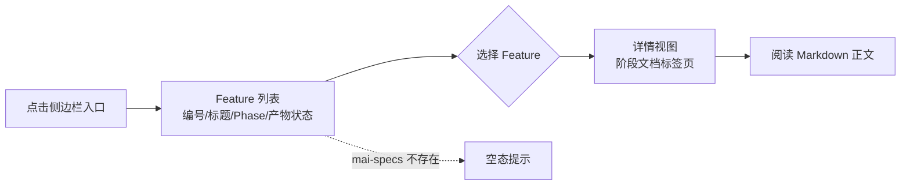

# PRD：SDD 工作台面板

> 状态：评审通过 | 负责人：liliang302

[返回需求简报](../BRIEF.md)

## 1. 背景与目标（Why）

- **背景/痛点**：my-ai-infra SDD 流程把一次交付的全部过程产物沉淀在项目根目录 `mai-specs/` 下（`ROADMAP.md` + 每个 Feature 的 `NNN-slug/BRIEF.md、spec/PRD.md、design/TECH_DESIGN.md、review/*、test/*`）。开发者在 DSH 会话中推进需求时，需要频繁切出编辑器用文件树回看这些规格文档，缺少一个"当前有哪些 Feature、各处在哪一阶段、还缺哪些产物"的可视化入口。
- **目标**：在 DSH Web 侧边栏提供一个 **SDD 工作台**页面：列出项目 `mai-specs/` 下的全部 Feature 及其阶段状态；点选 Feature 后可直接浏览各阶段规格文档内容。让 SDD 上下文在 DSH 内随手可查。
- **成功指标（可选）**：从打开面板到读完某 Feature 的 PRD 正文 ≤ 3 次点击；无需离开 DSH 即可完成。

## 2. 用户与场景（Who / When）

| 用户故事 ID | 目标用户 | 触发场景 | 用户故事：作为…我希望…以便… | 关联需求 |
|---|---|---|---|---|
| US-01 | 使用 DSH + my-ai-infra 的开发者 | 开始或接续一个 Feature 时 | 我希望在侧边栏一眼看到所有 Feature 的编号、标题、Phase 和已产出的阶段文档，以便快速判断从哪里接续 | FR-01, FR-02 |
| US-02 | 同上 | 实现过程中需要核对验收标准/设计约束 | 我希望点击 Feature 就能阅读其 PRD / TECH_DESIGN 等文档正文，以便不切换窗口 | FR-03, FR-04 |
| US-03 | 评审者 / 作业评审人 | 检查 SDD 过程产物是否齐备 | 我希望看到每个 Feature 的阶段产物清单与缺失标记，以便确认过程完整性 | FR-02 |

## 3. 总体业务流程

### BF-01：浏览并阅读某个 Feature 的规格文档

**参与者与起止**：用户在 DSH Web 侧边栏点击「SDD 工作台」入口开始；阅读完成离开面板结束。

**流程说明**：面板加载时扫描工作区根目录下 `mai-specs/`（FR-01）；每行展示 Feature 摘要与产物完整度（FR-02）；选中后按 BRIEF → PRD → TECH_DESIGN → 评审 → 测试的顺序呈现可用文档（FR-03/FR-04）。

## 4. 功能需求（What）

### 4.1 新增需求

| 需求编号 | 触发条件 | 输入 | 预期行为 | 输出/结果 | 关联需求编号 |
|---|---|---|---|---|---|
| FR-01 | 用户打开 SDD 工作台面板 | 工作区根目录路径 | Host 端只读扫描 `<root>/mai-specs/`：解析 `ROADMAP.md` 分区（规划中/进行中/已完成），枚举 `NNN-slug/` 目录及每目录内的阶段文档文件 | 列表数据到达 Client 并渲染；目录不存在时返回空列表 | US-01 |
| FR-02 | 列表渲染 | FR-01 扫描结果 | 每行显示：编号、slug、标题（取 BRIEF 一级标题）、Phase（BRIEF 元数据表）、阶段产物徽标（BRIEF/PRD/DESIGN/REVIEW/TEST 五类，存在=实心、缺失=空心） | 用户可判断各 Feature 所处阶段与缺口 | FR-01, US-01, US-03 |
| FR-03 | 用户点击某 Feature 行 | Feature id | Client 切换到该 Feature 详情视图，顶部为阶段文档标签（仅列实际存在的文档，含 context/ 素材文件名），默认选中第一个可用文档 | 详情视图替换列表视图；提供返回列表操作 | FR-02, US-02 |
| FR-04 | 用户选中某文档标签 | Feature id + 相对路径 | Host 读取该 Markdown 文件文本（大小上限见 NFR-02），Client 以排版可读的轻量渲染展示（标题层级、表格、代码块、列表、链接禁用跳转外链） | 正文可见；非 UTF-8/超限/越界路径给出错误提示而非空白 | FR-03, US-02 |
| FR-05 | 用户点击刷新按钮 | — | 重新执行 FR-01 扫描并更新列表与当前详情 | 会话中新写入 mai-specs 的文档无需重开面板即可见 | FR-01 |

### 4.2 变更需求

无（纯新增插件，不改动 DSH 既有行为）。

## 5. UI 视觉与交互（按需）

### UI-01：SDD 工作台面板（全局页面）

**设计依据**：对照官方 Plugins 管理页形态——侧边栏 `sidebar.panellist` 注册图标入口，主区 `main` slot 注册全局面板；沿用宿主主题 token 与列表行样式（现状参照 `packages/client/ui-plugin-manager`）。

| 页面区域/控件 | 新增/变更 | 对照设计的功能与交互说明 | 关联需求 |
|---|---|---|---|
| 侧边栏入口「SDD 工作台」 | 新增 | 图标 + 文案，点击进入面板 | FR-01 |
| 列表区 | 新增 | 每 Feature 一行：`999 · sdd-workbench-panel`、标题、Phase 徽章、五个产物小徽标；hover 高亮，Enter/点击进详情 | FR-02 |
| 头部工具条 | 新增 | 返回按钮（详情态）、Feature 标题、刷新按钮 | FR-03, FR-05 |
| 标签行 | 新增 | 阶段文档 tab：简报/PRD/技术设计/评审/测试计划/验收/素材；缺失阶段不出现 | FR-03 |
| 正文区 | 新增 | Markdown 轻量渲染，独立滚动 | FR-04 |

**状态与反馈**：加载中显示骨架/占位行；`mai-specs/` 不存在时显示空态「未找到 mai-specs/ 目录——先在项目里运行 `mai init`」；读取失败在正文区显示错误文案与原因；深浅色主题均可读。

## 6. 业务规则与约束（Rules）

| 规则 ID | 业务规则、状态流转、权限或数据约束 | 关联需求 |
|---|---|---|
| BR-01 | 面板对 `mai-specs/` 严格只读：不提供编辑、删除、创建任何文件的 UI 与接口 | FR-01..FR-05 |
| BR-02 | 文档读取路径必须限定在 `<root>/mai-specs/` 子树内且指向 `.md` 文件；越界（`..`、绝对路径、软链逃逸）拒绝并报错 | FR-04 |
| BR-03 | Feature 识别以目录名为准（`NNN-slug`）；ROADMAP 解析失败降级为目录枚举，不影响列表可用性 | FR-01, FR-02 |
| BR-04 | 插件是独立 bundle，不修改 DSH 内核包；卸载即消失，不留残留 | 全部 |

| 非功能 ID | 性能、可靠性、安全或可访问性要求 | 适用条件与验证口径 |
|---|---|---|
| NFR-01 | 扫描为浅层遍历（深度≤3，跳过 context/ 以外无关大目录），50 个 Feature 规模下列表首屏 < 1s | 本地 Web profile 实测 |
| NFR-02 | 单文档读取上限 1 MiB，超限报「文件过大」；非 UTF-8 拒绝 | 构造超大文件测试 |
| NFR-03 | 样式仅用 `--dsw-alias-*` 主题 token；不 require 宿主 Client 包 | 代码审查 + 深浅色目检 |

## 7. 范围与边界（Scope）

- **包含**：FR-01～FR-05 —— Feature 导航、阶段产物状态展示、规格文档查看、刷新。
- **不包含**：文档编辑；启动/推进 SDD 阶段（调用 mai CLI）；跨工作区多项目聚合；Markdown 中的图片资源代理渲染（正文图片以 alt 文本降级）。
- **依赖**：DSH Web 组合（`dsh web`）；my-ai-infra 生成的 `mai-specs/` 布局（`NNN-slug/BRIEF.md` 等）。

## 8. 研发资源（按需）

| 资源 ID | 类型 | 实际链接/路径或本文位置 | 用途/关联需求 | 确认与核验状态 |
|---|---|---|---|---|
| RES-01 | 图标 | `icon.svg`（随包原创绘制） | 侧边栏入口与插件详情 | 待设计 |
| RES-02 | 文案 | 本文 §5 与 locale/en.json、zh.json | UI 文案 | 已确认（中文为主） |

## 9. 验收标准（Acceptance Criteria）

### AC-01：面板可发现并列出 Feature

**关联**：FR-01, FR-02

- **Given**：源码版 `dsh web` 已启动，profile 安装了本插件，工作区含 `mai-specs/999-sdd-workbench-panel/`
- **When**：打开 Web 页面，点击侧边栏「SDD 工作台」
- **Then**：列表出现该行，显示编号 999、slug、标题「SDD 工作台面板」、Phase 徽章，以及 BRIEF 实心、其余按实际产出显示的徽标
- **验证方式**：人工步骤 + 浏览器 DOM 断言脚本

### AC-02：文档阅读闭环

**关联**：FR-03, FR-04

- **Given**：AC-01 通过
- **When**：点击该 Feature，依次切换 BRIEF / PRD / TECH_DESIGN 标签
- **Then**：正文渲染出对应 Markdown 的标题、表格与代码块；返回按钮回到列表
- **验证方式**：人工步骤 + DOM 断言

### AC-03：空态与错误态

**关联**：FR-01, FR-04, BR-02, NFR-02

- **Given**：工作区根目录没有 `mai-specs/`
- **When**：打开面板
- **Then**：显示引导空态而非报错白屏；对一个指向 mai-specs 之外的路径发起读取请求，Host 拒绝
- **验证方式**：临时目录实测 + 越界路径注入测试

### AC-04：只读约束

**关联**：BR-01

- **Given**：面板任意状态
- **When**：检查全部交互与 Host 接口面
- **Then**：不存在任何写文件路径的能力；`mai-specs/` 内容在整轮使用后字节不变
- **验证方式**：静态检查 + 前后哈希对比

### AC-05：安装与卸载

**关联**：BR-04

- **Given**：干净 profile
- **When**：经 Plugin Manager 安装本 bundle 并启用，随后停用
- **Then**：启用后侧边栏出现入口；停用/卸载后入口与页面消失，无控制台报错
- **验证方式**：人工步骤

## 待确认事项

| 问题/假设 | 来源 | 影响的编号/范围 | 是否阻塞 | 决策人/状态 |
|---|---|---|---|---|
| 「工作区根目录」取当前活跃 Session 的 cwd，还是固定为 dsh 启动目录？ | BRIEF 澄清 | FR-01 | 否 | 已定：优先当前 Session 工作目录，无 Session 时用启动目录（设计阶段落实细节） |
| Markdown 渲染深度 | BRIEF 澄清 | FR-04 | 否 | 已定：自研轻量渲染器（MVP），不做插件生态级 CommonMark 全兼容 |

## 变更记录（维护时）

| 日期 | 变更及依据 | 影响的编号/范围 |
|---|---|---|
| 2026-11-20 | 初版，基于 BRIEF 与作业材料 | 全部 |
